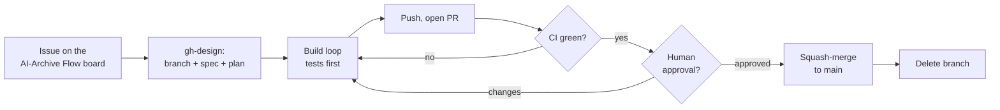
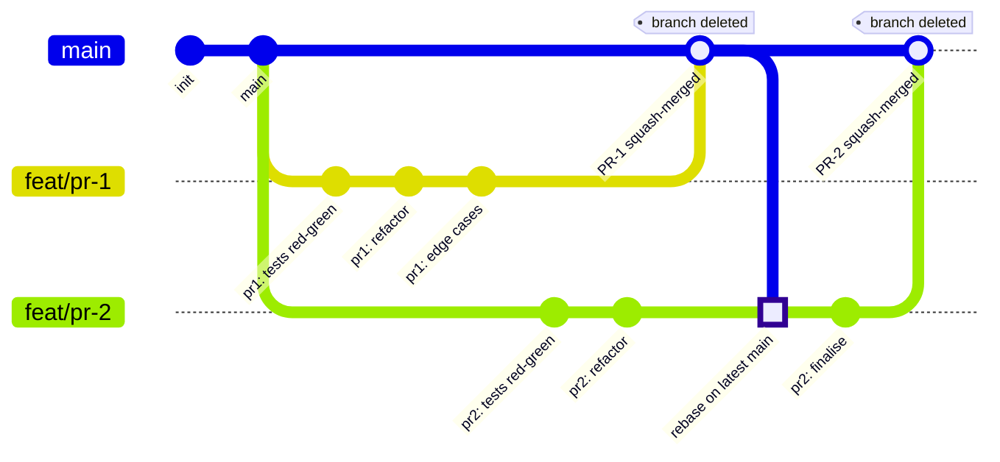

# Development workflow

How we build with AI coding agents (Claude Code, opencode). Agents produce
large diffs quickly; without a shared flow that turns into merge conflicts,
unreviewed code and lost design intent. The agent-facing rules are in
`AGENTS.md`; this page is the human-facing process.

## Lifecycle at a glance

A CI failure or a review change request loops back into the build loop; a
clean pass squash-merges to `main` and the branch is deleted.

## Branching model: trunk-based

- `main` is the single source of truth and is always releasable: it builds and
  the app runs.
- All work happens on **short-lived branches cut from `main`**. Target lifetime
  1–2 days. If a branch lives longer, the unit of work was too big — split it.
- **No long-lived integration or epic branches.** No `develop`. A `spec+plan`
  branch with implementation branches hanging off it is an epic branch in
  disguise — it defers all integration to one merge and re-creates big-bang
  integration. Don't.
- `main` is protected by a ruleset: no direct pushes, merge only via PR with
  green `lint` and `test` checks and at least one human approval. Files that
  define the quality gates are listed in `.github/CODEOWNERS` and need Peter's
  review (ADR 0129).
- Branch naming: `<issue>-<short-desc>` for board issues (what `gh-design`
  creates), `chore/<short-desc>` otherwise. Agent sessions may use their own
  `claude/...` branch names.

## Specs and plans live on the feature branch

- `gh-design` cuts the issue branch `<N>-<slug>` from `main` and commits the
  spec (`docs/specs/<date>-<slug>-design.md`) and the plan
  (`docs/plans/<date>-<slug>.md`) there. `gh-handoff` then hands the branch to
  a cloud session to implement.
- The PR carries the spec, the plan and the code together, so the reviewer
  reads intent and diff in one place. For a risky design, open the PR as a
  draft with only the spec and plan and get a sign-off before building.
- Every spec ends with **Manual acceptance flows** (see `AGENTS.md`).
- A plan is scratch for the PR that implements it. Once that PR merges, the
  code, tests and spec are the record; delete the plan in the same PR or
  soon after, so later agents don't read it as current truth.

## The build loop

1. **Agree the design.** For anything non-trivial, start in plan mode and
   let the agent ask clarifying questions before it writes code.
2. **Build test-first.** A failing test, then the change. Granular commits
   are fine; they get squashed at merge.
3. **Review your own diff.** When the work is done, run `/code-review`
   (bugs) and `/simplify` (reuse and cleanup) on the whole diff and apply
   the fixes before asking a human. This is hygiene, not a
   substitute for human review.
4. **Run the gates locally.** `pre-commit run --all-files` and
   `pytest -n auto`; CI runs the same checks.
5. **Push and open the PR.**

Parallel work in isolated worktrees is fine and invisible to the rest of
the team; one worktree maps to one branch.

## Working in parallel (two or more developers)

- Each developer cuts their branch from the current `main`.
- Design the PR breakdown so parallel branches are **independent by default** —
  no shared state, mergeable in any order.
- Before merging, rebase onto the latest `main`: `git fetch && git rebase
  origin/main`. Whoever merges second integrates first.
- Resolve conflicts on your branch, re-run tests, then merge. **Never merge a
  branch that has not been rebased onto the current `main`.**

Both branches are cut from the same `main` commit and develop in parallel. Each
branch's granular TDD commits collapse into a single squash-merge commit on
`main`, after which the branch is deleted. `feat/pr-2` merges second, so it
rebases onto the latest `main` — picking up PR-1 — before its own merge.

## Dependent work: stacked PRs

When PR-2 genuinely depends on PR-1, do not create an epic branch. Either:

- **Serial** — finish PR-1, merge to `main`, then cut PR-2 from updated `main`.
  Simple and safe; you pay the wall-clock wait.
- **Stacked** — cut PR-2 from PR-1's branch and open it targeting PR-1's branch.
  When PR-1 merges to `main`, retarget PR-2 to `main` and restack
  (`git rebase --update-refs`, or a stacking tool).

Either way, each PR still merges into `main` individually and in order. The
stack is a development and review convenience — not an integration branch.

### PR size

Aim for under ~600 changed lines, not counting generated files and
baselines. Larger work splits into stacked PRs as above: big PRs get
skimmed, and review is the bottleneck.

## Incomplete work: feature flags

Code that lands before it is user-visible goes behind a feature flag. This
decouples "merged" from "released" and is what makes a multi-PR feature safe to
develop on trunk.

## Merging

- **Squash-merge every PR.** A branch carries many granular TDD commits; `main`
  gets one commit per PR.
- The squash commit message: a clear summary plus a reference to the ticket and
  the plan step.
- **Delete the branch immediately after merge.** Remove the worktree
  (`git worktree remove`).
- The next task starts from a fresh worktree off the updated `main`.

## CI

- `.github/workflows/ci.yml` runs on every PR and on `main`: ruff check,
  ruff format, import contracts, the erosion (complexity) gate, basedpyright
  against its baseline, docstring coverage (`interrogate`), pylint
  duplicate-code and the full test suite.
- The baselines only tighten. On a PR the erosion gate also fails when a
  function changed since the merge-base got more complex, and when erosion
  or max CC fell without the baseline being lowered (run `--write-baseline`
  and commit). `tools/type_baseline_gate.py` fails when the basedpyright
  baseline grew. `tools/frontend_size_gate.py` caps `static/*.js` at 500
  lines per file and 80 lines per function (a function's own lines; nested
  functions count separately); the few already over are baselined in
  `.frontend-size-baseline.json` and may only shrink. Raising any baseline
  is Peter's call (ADR 0129).
- Green CI is a required merge gate. A local "tests pass" is a local claim;
  CI is the team's source of truth.

## Code review

- **Every PR gets an independent Claude review**
  (`.github/workflows/claude-code-review.yml`) when it opens or is marked
  ready. It posts only findings it has verified, as inline comments, and
  checks the change against the CLAUDE.md files on its path;
  `backend/CLAUDE.md` names what counts as a serious problem here. The
  agent driving the PR fixes each finding or answers it with a reason.
  It reviews a PR once, skips drafts, and runs on Peter's Claude
  subscription.
- The PR template asks what changes for the user, how it was tested, the
  risk level and how to undo it. Peter merges on green CI with no open
  review finding; for a High-risk PR he also asks the agent for a
  plain-language explainer of what could go wrong.
- The reviewer reads the spec and plan **first**, then reviews the diff
  against stated intent. Review the intent, not just the lines.
- AI self-review covers mechanical issues — dead code, missed edge cases, test
  gaps. Humans own architecture, security, and "is this the right thing".
- One human approval minimum. Do not rubber-stamp: when AI multiplies output,
  human review becomes the real bottleneck.
- If parallel worktrees flood the review queue, apply a WIP limit on open PRs
  per author.

## Maintenance loop

Gates stop complexity from growing; this loop pays it down. A weekly
scheduled routine, `refactor-hotspot`, takes the highest-mass offender from
the erosion gate's report that no PR touched in the last 7 days (skipping
any with an open PR), does a behaviour-preserving extraction (existing tests
unchanged; new tests for extracted helpers allowed), and opens one PR
labelled `refactor` with before/after CC and erosion in the description and
the baseline lowered. It runs the full suite and `/e2e`, and never touches
the CatDV seat. The routine is created only with Peter's approval of it and
its model.

## Commit attribution

- AI-assisted commits carry a `Co-authored-by:` trailer (or the team's agreed
  marker).
- "Who or what produced this change" must be queryable from history — this
  matters for audit (DORA / NIS2).

## Per-PR checklist

**Before opening the PR**

- [ ] Branch cut from the current `main`
- [ ] Scoped to one issue or one slice of its plan
- [ ] Tests written and passing locally
- [ ] `/code-review` and `/simplify` run on the diff
- [ ] Walkthrough scenario updated if the UI changed
- [ ] Rebased onto the latest `origin/main`

**Before merging**

- [ ] Green CI
- [ ] One human approval
- [ ] Plan checkboxes ticked (or the plan deleted)
- [ ] Feature flag in place if the work is not yet user-ready

**After merging**

- [ ] Squash-merged
- [ ] Branch deleted
- [ ] Worktree removed, if you used one
